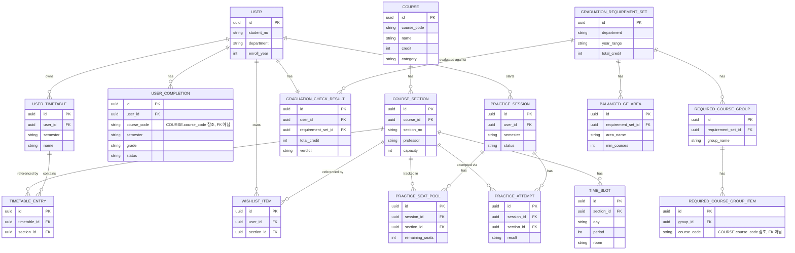

# ERD

`docs/API_SPEC.md`에 정리된 도메인·필드를 기준으로 그린 엔티티 관계도입니다.
원본 `수강신청도우미_ERD.pdf`(노션)를 아직 저장소에서 확인할 수 없어, API 명세 역산으로 다시 그렸습니다 —
원본과 차이가 있으면 원본을 기준으로 이 문서를 고쳐주세요.

각 엔티티가 어느 API로 노출되는지는 `docs/API_SPEC.md` 부록 A를 참고하세요.

## 참고

- `USER_COMPLETION.course_code`, `REQUIRED_COURSE_GROUP_ITEM.course_code`는 `COURSE.course_code`를 값으로 참조하지만 API 명세상 DB FK로 명시되어 있지 않아 느슨한 참조로 표시했습니다. 실제 구현 시 FK로 걸지 문자열 참조로 둘지는 ORM 선택과 함께 정합니다.
- `GRADUATION_CHECK_RESULT`는 사용자 기준 1:1이지만, 어떤 `GRADUATION_REQUIREMENT_SET`으로 판정했는지 추적하려면 `requirement_set_id`가 필요해 추가했습니다 (API 명세 예시 응답엔 없던 필드 — 구현 시 팀 확인 필요).
- 기초 데이터(COURSE 계열)가 모든 도메인의 뿌리이므로, `docs/API_SPEC.md` 부록 B 순서(courses → users 필드 교체 → timetables/wishlist → graduation → practice)대로 구현하면 이 ERD도 같은 순서로 채워집니다.
